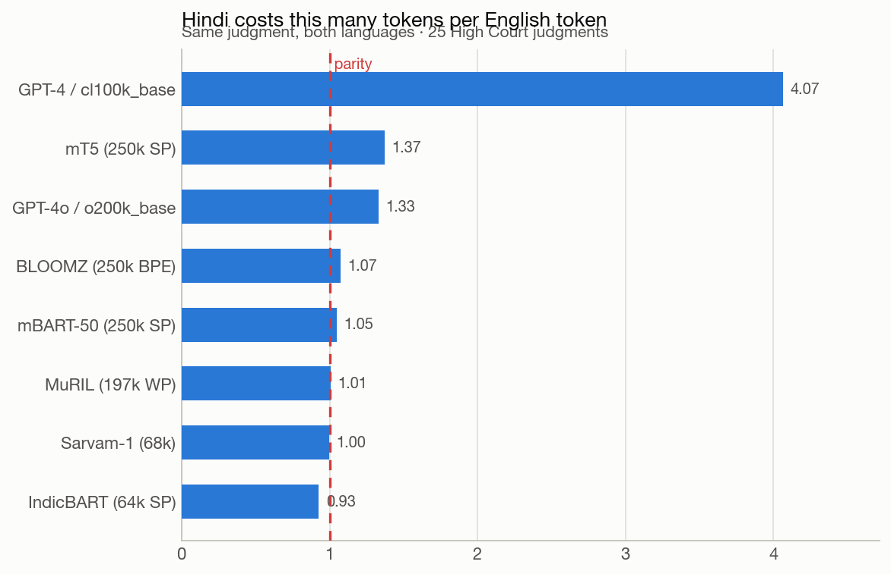
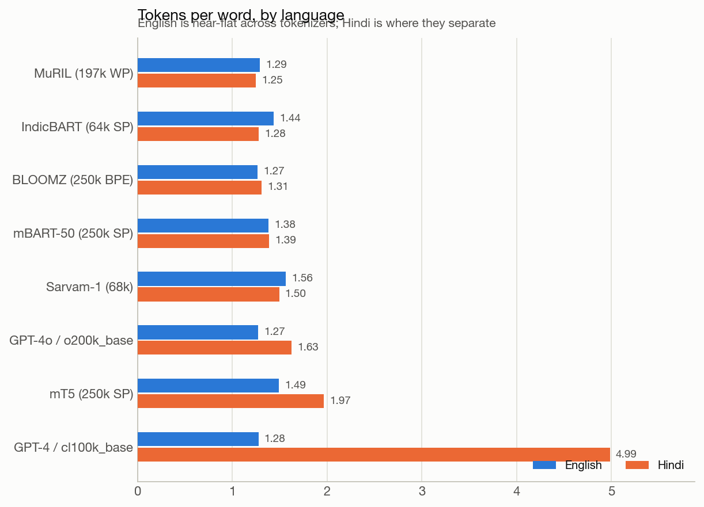
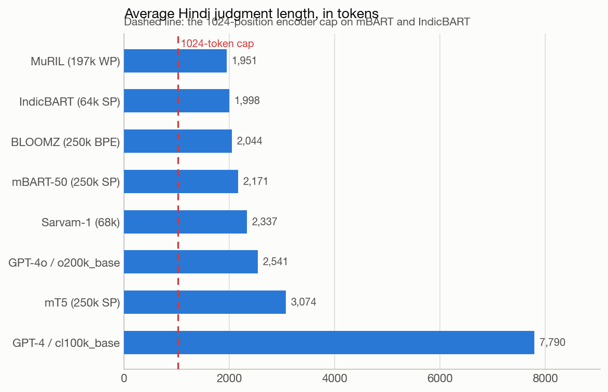
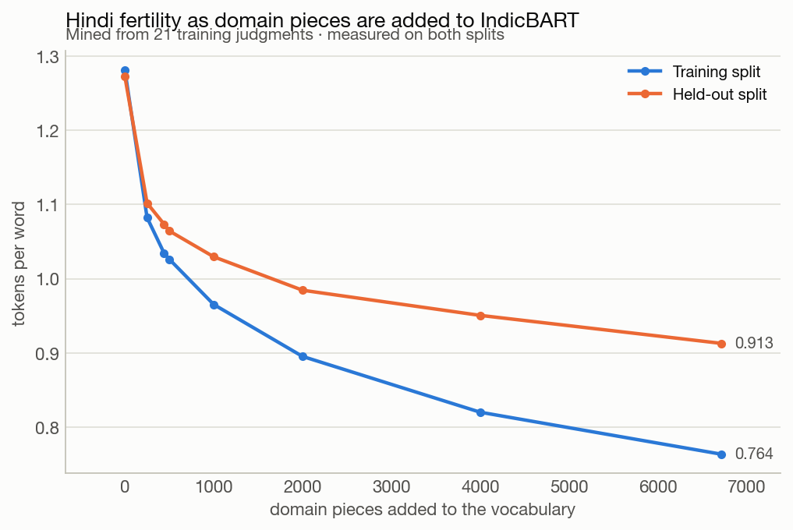
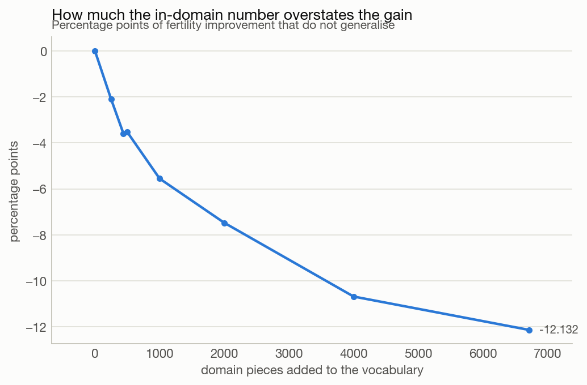
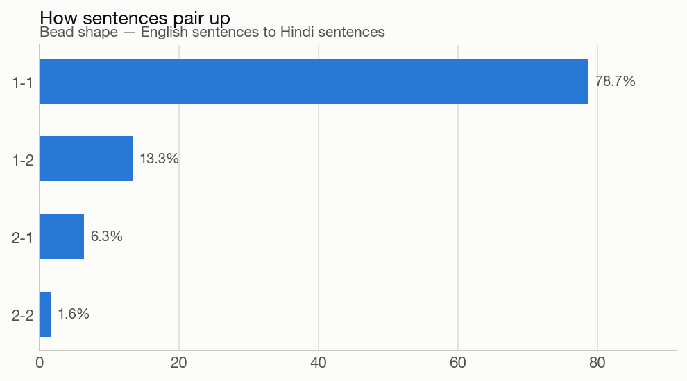
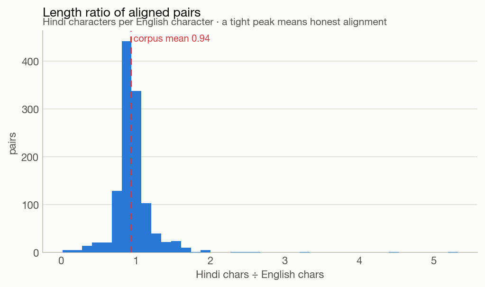
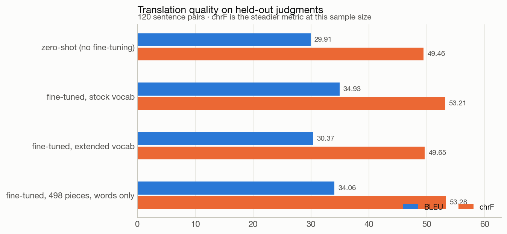
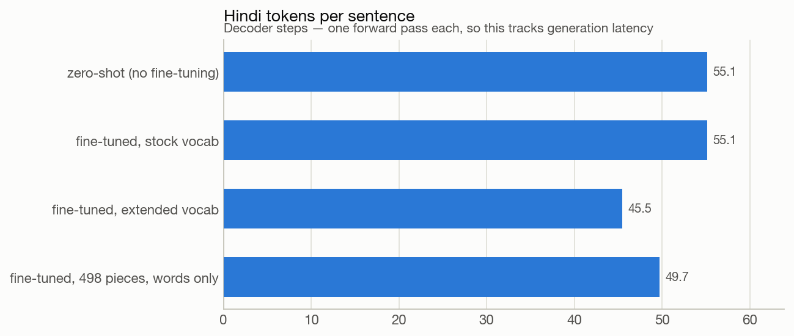

# Token-efficient English to Hindi translation for Indian court judgments

Adalat AI ML assignment. All five tasks are complete. This report records the
decisions, the numbers behind them, and what did not work.

## Summary

Three results carry the work.

**Tokenizer choice is almost entirely a Hindi decision.** Across eight
tokenizers, English fertility varies by 23% and Hindi fertility varies by 299%.
GPT-4's `cl100k` costs 4.07 Hindi tokens per English token on the same judgment,
which is 4x the token bill and 16x the attention compute of the best option.

**Domain vocabulary extension works, but only with whole-word pieces.** Adding
498 legal terms to mBART-50 cut Hindi tokens by 9.8% at no measurable quality
cost. Adding 504 pieces that included multi-word phrases cut tokens by 17.5% and
gave back 3.56 chrF, wiping out most of what fine-tuning had gained.

**Fine-tuning on 907 sentence pairs is worth 5.02 BLEU and 3.75 chrF.** The model
learns legal register, not just vocabulary: `Leave granted` stops being rendered
as "holiday given" and becomes the correct term of art.

A fourth result is about the data rather than the method. Five of the thirty
Hindi files contain no Hindi at all, and no length-based check detects them.

## 1. The corpus, and a data problem worth stating first

The dataset is 30 High Court judgments, each as OCR'd English with a Hindi
translation.

Five of the Hindi files had their Devanagari destroyed at encoding time and
survive only as runs of `?`:

```
1.???????????. 1181(??/??)???? 1998?????????????????????????
```

These files are the right size, their English halves are intact, and their
Hindi-to-English length ratios sit inside the normal range. Every check based on
length passes them. They are detectable only on script content, which is what
`court_mt.corpus.validate` tests: a genuine Hindi judgment in this corpus runs 60
to 77% Devanagari by character, and these run 0%.

Leaving them in is not a cosmetic error. A page of `?` is cheap and uniform to
tokenise under every vocabulary, so the corrupted files compress the differences
between tokenizers. Removing them moved GPT-4 parity from 3.56 to 4.07 and moved
MuRIL from sixth place to third.

The source PDFs do still contain Devanagari, but their font CMaps are broken and
extraction returns text peppered with control characters (`प्रति\x03वेद्य`).
That is measurably worse than the 25 intact files, and mixing two text qualities
into one corpus would confound every comparison. The five pairs are quarantined
to `data/processed/quarantine.jsonl` rather than deleted, so the decision is
auditable.

**Working corpus: 25 paired judgments, 216,773 English characters, 202,738 Hindi
characters.** Hindi runs slightly shorter than English in characters (median
ratio 0.93), which matters for the next section.

## 2. Tokenizer analysis

### Method

Eight tokenizers spanning the three vocabulary designs a deployment actually
chooses between:

| design | tokenizers |
|---|---|
| English-centric byte BPE | GPT-4 `cl100k`, GPT-4o `o200k`, BLOOMZ |
| multilingual SentencePiece | mBART-50, mT5 |
| Indic-specialised | IndicBART, MuRIL, Sarvam-1 |

Two named in the brief are absent for recorded reasons. **SUTRA** publishes no
tokenizer artefact (it is API-only), so its claimed Indic token reduction cannot
be reproduced. **IndicBERT**'s repository became access-restricted during the
work. Both stay in `configs/tokenizers.yaml` marked `skip` with the reason, so
the roster documents what was considered rather than only what was measured.

Four families of metric, each answering a different question:

**Fertility** (tokens per word) measures verbosity within one language. It is not
comparable across languages, because Hindi and English build words differently.

**Parity** (Hindi tokens divided by English tokens, for the same judgment) is the
headline. Since the Hindi text is *shorter* than the English in characters, any
parity above 1.0 is a pure encoding penalty rather than a longer document.

**Context fit and cost.** Whether a judgment fits the model's input window is a
step function, so it is reported as the share of judgments that fit. Cost splits
into a token-linear index (billing, feed-forward) and a quadratic index
(attention), because at judgment length the quadratic term dominates.

**Losslessness.** A tokenizer can look cheap by discarding characters. Each text
is encoded, decoded, and compared. Character loss and whitespace loss are
reported separately: the first is data loss, the second is a detokenisation cost.

All corpus ratios are computed as ratio of sums, never as the mean of
per-document ratios, which would weight a two-page order the same as a forty-page
judgment.

### Results

25 judgments, both languages.

| tokenizer | vocab | EN fertility | HI fertility | parity | HI chars/token | lossless |
|---|---:|---:|---:|---:|---:|---|
| MuRIL | 197,285 | 1.290 | 1.249 | 1.008 | 4.156 | yes, re-spaces |
| IndicBART | 64,014 | 1.436 | 1.279 | **0.928** | 4.058 | drops quote marks |
| BLOOMZ | 250,680 | 1.268 | 1.308 | 1.075 | 3.967 | yes |
| mBART-50 | 250,054 | 1.382 | 1.389 | 1.047 | 3.736 | yes, re-spaces |
| Sarvam-1 | 68,096 | 1.564 | 1.496 | 0.996 | 3.470 | yes |
| GPT-4o `o200k` | 200,019 | 1.273 | 1.627 | 1.331 | 3.191 | yes |
| mT5 | 250,100 | 1.493 | 1.968 | 1.373 | 2.638 | yes, re-spaces |
| GPT-4 `cl100k` | 100,277 | 1.277 | **4.986** | **4.066** | 1.041 | yes |





Deployment consequences:

| tokenizer | mean HI tokens/judgment | fits 1024 | fits 4096 | token cost | attention cost |
|---|---:|---:|---:|---:|---:|
| MuRIL | 1,951 | 4% | 100% | 1.00x | 1.00x |
| IndicBART | 1,998 | 0% | 100% | 1.02x | 1.05x |
| mBART-50 | 2,171 | 0% | 96% | 1.11x | 1.24x |
| GPT-4o `o200k` | 2,541 | 0% | 96% | 1.30x | 1.69x |
| mT5 | 3,074 | 0% | 80% | 1.58x | 2.50x |
| GPT-4 `cl100k` | 7,790 | 0% | **4%** | **3.99x** | **16.02x** |



### What the numbers say

**English fertility sits in a narrow band; Hindi does not.** Every one of these
tokenizers is trained heavily on English, so English costs 1.27 to 1.56 tokens
per word across the whole set. Hindi costs 1.25 to 4.99. Choosing a tokenizer is
therefore a decision about the Indic side and almost nothing else.

**`cl100k` is unusable for Devanagari, and the reason is visible in one column.**
It carries 1.04 characters per token on Hindi. That is the signature of byte
fallback: the script has almost no dedicated merges, so each character decomposes
into its three UTF-8 bytes and a token buys barely one character. Only 4% of
judgments fit a 4k context under it; for every other tokenizer it is 80 to 100%.

Segmenting one sentence makes it concrete. For
`अपीलार्थी ने भारतीय दण्ड संहिता की धारा 302 के अन्तर्गत याचिका दायर की।`
(71 characters, 13 words):

```
MuRIL        15 tokens   अपील ##ार्थी ने भारतीय दण्ड संहिता की धारा 302 के अन्तर्गत ...
IndicBART    16 tokens   _अपील ार्थी _ने _भारतीय _दण्ड _संहिता _की _धारा _30 2 _के ...
GPT-4o       26 tokens   अप ील ार्थ ी  ने  भारतीय  द ण्ड  सं ह िता  की  ध ारा   302 ...
GPT-4        69 tokens   � � प ी ल ा� � ्� � ी  � � े  � � ा� � त ी � ...
```

The English translation of that sentence costs about 13 tokens in *both*
`cl100k` and IndicBART.

**A large vocabulary is not the fix; a relevant one is.** IndicBART reaches the
best parity (0.928) on the smallest vocabulary in the set, beating mT5's 250k
(1.373) and matching models four times its size.

**Parity below 1.0 is achievable and correct.** IndicBART and Sarvam-1 encode
Hindi slightly more cheaply than the matching English, which is the right outcome
given the Hindi text is shorter in characters.

**Cheap is not automatically lossless.** Every tokenizer reports a zero unknown
rate, so `<unk>` is not where losses hide, which is exactly why a round-trip
check is needed. IndicBART is the only one that drops characters: its normaliser
collapses the doubled apostrophes these judgments use to quote defined terms, so
`(''एफआईआर'')` comes back as `("एफआईआर")`. MuRIL preserves every character but
re-spaces punctuation on all 25 documents, which a legal-formatting pipeline
would have to repair.

**Chunking is a precondition, not an optimisation.** Essentially no judgment fits
a 1024-position encoder under any tokenizer.

## 3. Vocabulary optimisation

Two routes were tested, both measured on held-out judgments.

### Route A: train a vocabulary on the legal corpus

This fails, and the failure is informative. The corpus supports roughly 6,000
distinct SentencePiece pieces no matter how many are requested (21 training
judgments do not contain enough distinct material), and at that ceiling the
domain-only vocabulary is **worse** on held-out Hindi than stock IndicBART:
1.676 tokens per word against 1.273.

A tokenizer trained on 21 documents has seen this corpus's vocabulary but none of
the morphology of Hindi at large. Pretraining scale is not replaceable at this
data volume. It can only be supplemented.

### Route B: extend a pretrained vocabulary

Candidates are corpus n-grams ranked by `frequency x (tokens each currently
costs)`, not by raw frequency. A word already encoded as one token saves nothing
however often it appears, while a five-token legal compound occurring twenty
times saves eighty.

Two filters keep the vocabulary honest, and both were added after the first
version produced wrong results. Candidates must contain **and begin with** a
letter, and mining is pinned to Devanagari. Without those, bare section numbers
and dates (`482`, `02 11 2022`, `11 2011 को`) are mined as "Hindi" pieces. They
tokenise identically in English, so they quietly cheapen the source side too, and
they spend an embedding row on a string that will never recur.

Pieces are injected into the SentencePiece model proto rather than registered
with `add_tokens`. The distinction matters: `add_tokens` registers strings in a
trie that runs before normalisation and pre-tokenisation, so the matched string
is cut out of the text and the preceding space can become its own token.
Injected pieces are ordinary vocabulary entries that the Viterbi segmenter weighs
against the pretrained ones. For a unigram model the injected score must be a
real log-probability or the segmenter never chooses the piece, so scores are
estimated from the corpus.

### Results, on held-out judgments

| pieces added | held-out fertility | HI change | EN change | pair change | added params |
|---:|---:|---:|---:|---:|---:|
| 0 | 1.2726 | 0% | 0% | 0% | 0 |
| 250 | 1.1019 | -13.4% | -0.05% | -6.5% | 0.26M |
| **441** | **1.0735** | **-15.6%** | **-0.05%** | **-7.5%** | **0.45M** |
| 1,000 | 1.0295 | -19.1% | -0.05% | -9.2% | 1.02M |
| 4,000 | 0.9506 | -25.3% | -0.05% | -12.1% | 4.10M |
| 6,713 | 0.9129 | -28.3% | -0.05% | -13.6% | 6.87M |



**Measuring on held-out text is not optional.** Pieces mined from the training
split make that split cheaper almost by construction. The gap between the two
curves grows from 2.1 points at 250 pieces to 12.1 points at 6,713.



**There is no knee.** Every doubling of the budget keeps buying roughly three
points of held-out fertility out to the end of the candidate pool. The expected
diminishing-returns story is simply not what the data shows.

The binding constraint is trainability instead. Each added piece creates a
randomly initialised embedding row, useful only once training has seen the piece
enough times to move it off its initialisation. Requiring at least ten
occurrences across the 21 training judgments sets the budget at **441 pieces**,
for a 15.6% reduction in Hindi tokens at a cost of 0.45M parameters (0.2% of
IndicBART).

**Three numbers, three questions.** The Hindi figure governs generation latency,
since the decoder emits one token per forward pass. The English figure must stay
near zero, and confirms the extension did not disturb the source side of a shared
vocabulary. The pair total governs the size of a packed training example. They
are not competing versions of one number.

## 4. Dataset preparation

### Segmentation

Off-the-shelf sentence splitters break on judgments, because a judgment is mostly
periods that do not end sentences: `27.05.2003`, `A.I.R. 1963 S.C. 1295`,
`Mr. P.S. Patwalia`, `M/s. Tata Ltd. v. State of U.P.`

The approach is protect-then-split: mask the periods known not to end a sentence,
split what remains, then unmask. Masking rather than rewriting keeps the surface
text byte-identical, which is what "preserve legal formatting" actually requires.
A segmenter that normalises citations while cutting them has already lost the
formatting.

25 documents yield 1,309 English and 1,426 Hindi sentences. The counts differ by
design: the Hindi translation merges some sentences and splits others, which is
precisely why pairing by position would be wrong.

### Alignment

Gale-Church (1993) aligns on the observation that a translated sentence is about
a constant multiple of its source's length in characters, with roughly normal
deviation. Dynamic programming finds the cheapest sequence of beads across the
whole document, so a local merge costs a little rather than derailing everything
after it.

This was chosen over embedding-based aligners (LaBSE, LASER) because it needs no
model, runs on CPU in milliseconds, and is the standard baseline for clean
parallel documents. Embeddings are the upgrade if quality checks come back poor.

`c` and `s2` are calibrated on this corpus rather than taken from the paper's
English-German constants, because Hindi runs shorter than English here. **`s2` is
the variance of the length-normalised difference, not of the length ratio.** That
distinction is worth stating because getting it wrong is silent: estimating the
ratio variance gives a number roughly 1000x too small, the model becomes
overconfident, every honest pair looks like an outlier, and the aligner collapses
onto 2-2 beads because merging is its only way to average away deviations it
considers impossible. Fitting the right quantity moved the 1-1 share from 16.8%
to 78.7%.

Calibrated values: `c = 0.9353`, `s2 = 11.708` (the paper's English-German value
is about 6.8).

| bead | share |
|---|---:|
| 1-1 | **78.7%** |
| 1-2 | 13.3% |
| 2-1 | 6.3% |
| 2-2 | 1.6% |





### Filtering

1,185 beads reduce to **1,127 pairs**, a 4.9% rejection rate: 30 on length ratio,
24 too short, 4 on alignment cost. 93% of English sentences and 95.5% of English
words survive into training pairs.

The cost threshold is a backstop for structurally broken alignments, not a
quality bar. Set tight (at roughly the 87th percentile of observed costs) it
discarded 240 correctly aligned pairs, about a fifth of the training data.
`s2` is fitted on document lengths where sentence-level variation averages out,
so freely translated sentences score as outliers even when the pairing is right.
The threshold now sits near the 99th percentile.

### Splits

80/10/10 at **document** level, never sentence level. Judgments repeat their own
terminology relentlessly, so sentences from one judgment on both sides of a split
would leak exactly the domain vocabulary this project is trying to learn.

| split | documents | pairs | share | English words |
|---|---:|---:|---:|---:|
| train | 19 | 907 | 80.5% | 27,008 |
| dev | 3 | 100 | 8.9% | 3,633 |
| test | 3 | 120 | 10.6% | 4,282 |

The shares are not exact because whole documents move together, and each carries
however many sentences it happens to contain.

## 5. Model selection and training

### Base model

**`facebook/mbart-large-50-many-to-many-mmt` (611M).**

Task 1 ranked IndicBART higher on token efficiency (parity 0.928 against
mBART's 1.047), but IndicBART is a *denoising* pretrained model, not a
translator. It carries no translation pipeline and would have to learn
translation itself from 907 sentence pairs. mBART-50-mmt already translates
English to Hindi, so fine-tuning measures adaptation to legal register, which is
what the brief asks for.

This tension is itself a finding: **the most token-efficient model was not the
most trainable one.** The zero-shot baseline of 29.91 BLEU confirms the choice,
since IndicBART would have started near zero and spent all 907 pairs learning to
translate at all.

### Vocabulary integration

For mBART the extension uses `add_tokens`, reversing the choice made in Task 1,
for a concrete reason. mBART-50's vocabulary is laid out
`[specials][sentencepiece][language codes][mask]`. Injecting pieces into the
proto shifts every language-code id and misaligns their *pretrained* embeddings.
`add_tokens` appends past the end, so nothing moves. Measured on held-out Hindi
the two approaches are within half a point (16.3% against 16.8%), which is a
cheap price for not relocating pretrained rows.

**New rows are mean-initialised** from the embeddings of the pieces they replace,
so a piece meaning "High Court" starts between "High" and "Court" rather than at
noise. With 907 pairs, random rows would not train out.

**New rows are trainable, and must be.** mBART sets `tie_word_embeddings=True`,
so the embedding matrix is also the decoder's output projection: the logit for
emitting a token is `hidden_state · emb[token]`. A frozen new row is an
uncalibrated classifier row. Since the extended run's labels contain these
tokens, freezing them would train the model toward targets it is not allowed to
represent, and the run would lose for reasons unrelated to the vocabulary. A
gradient mask confines updates to the new rows.

### Training configuration

LoRA rank 16, alpha 32, dropout 0.05, on the attention projections
(`q_proj`, `k_proj`, `v_proj`, `out_proj`). Feed-forward layers are excluded
because they more than double adapter size for little gain at this data scale.

**4.72M trainable parameters of 615.6M, or 0.77%.** Learning rate 1e-4, 5 epochs,
effective batch 8, max length 192, beam 4 at evaluation, fixed seed.

### Practical note on single-GPU feasibility

The runs do not fit on a 24GB unified-memory Mac, and the reason is specific.
Making the embedding trainable costs about 3GB (1.03GB gradient plus 2.05GB
optimizer state) because `requires_grad` is a property of the whole 250k-row
tensor even though the mask confines updates to 498 rows. That is the price of
the tied-embedding fix, and it is memory rather than parameters.

On a 16GB dedicated GPU it is comfortable. Each stage runs as its own process
(`notebooks/run_stage.py`) and writes results to disk, so a failure in one costs
nothing already computed, and memory is fully released between stages.

## 6. Evaluation

### Quantitative

120 held-out sentence pairs from 3 judgments the model has never seen.

| run | BLEU | chrF | HI tokens/sentence | token change |
|---|---:|---:|---:|---:|
| zero-shot, no fine-tuning | 29.91 | 49.46 | 55.1 | 0% |
| **fine-tuned, stock vocab** | **34.93** | **53.21** | 55.1 | 0% |
| fine-tuned, 504 pieces with phrases | 30.37 | 49.65 | **45.5** | **-17.5%** |
| fine-tuned, 498 pieces, words only | 34.06 | **53.28** | 49.7 | -9.8% |





**chrF is the primary metric here, not BLEU.** With 120 sentences, BLEU's 4-gram
matching is noisy against a morphologically rich target where a correct
translation often differs from the reference by an inflection. BLEU is reported
because the brief names it. Scores use sacrebleu's `flores101` tokenizer, which
is appropriate for Devanagari but reads higher than the default `13a`, so these
numbers are not directly comparable to en-hi BLEU quoted elsewhere.

COMET was not run. It requires a separate model download and, at 120 sentences,
would add a third noisy estimate rather than new information.

Three readings:

1. **Fine-tuning works.** +5.02 BLEU and +3.75 chrF on 907 pairs.
2. **Phrase pieces undo it.** The phrase extension saves the most tokens and
   lands barely above the un-fine-tuned baseline.
3. **Whole-word pieces are free.** 53.28 chrF against stock's 53.21 is
   statistically indistinguishable, with 9.8% fewer decoder steps. BLEU is 0.87
   lower, which is inside noise at this sample size; a real regression would have
   moved chrF too.

### Why phrases hurt

The two mining strategies put different things in the vocabulary. Their top
pieces, same corpus, same ranking function:

| phrases (up to 3 words) | words only |
|---|---|
| `के लिए` ("for the") | `अपीलकर्ता` (appellant) |
| `उच्च न्यायालय` (High Court) | `प्रत्यर्थी` (respondent) |
| `करने के लिए` ("in order to") | `सीआरपीसी` (CrPC) |
| `है कि` ("that is") | `इलाहाबाद` (Allahabad) |
| `किया गया` ("was done") | `एफआईआर` (FIR) |

Phrase mining spends its best slots on function-word glue. Those are exactly the
pieces a decoder needs to compose freely, and freezing them into single tokens
removes that freedom. Word mining spends the same slots on terms of art, which
have stable meanings and no compositional role, so a dedicated token costs
nothing.

### Qualitative

**A term of art.** `Leave granted` means permission to appeal, not vacation.

```
EN                   Leave granted.
reference            अनुमति प्रदान की गई।
zero-shot            छुट्टी दी गई।            ("holiday given")
fine-tuned stock     अनुमति दी गई।             (correct sense)
fine-tuned words     अनुमति प्रदान की गई।      (exact match)
```

**Archaic legal phrasing.** `impugned` and `set aside` both have fixed Hindi
legal renderings.

```
EN                   13. With the aforesaid observations, the appeal is
                     accordingly allowed, and the Impugned Order is set aside.
reference            ... आक्षेपित आदेश को अपास्त कर दिया जाता है।
zero-shot            ... प्रतिवादित आदेश को अलग रखा जाता है.
fine-tuned stock     ... आक्षेपित आदेश को अपास्त कर दिया जाता है।
fine-tuned words     ... आक्षेपित आदेश अपास्त कर दिया जाता है।
```

The baseline gives `प्रतिवादित` ("defended") for *impugned* and
`अलग रखा जाता है` ("kept aside") for *set aside*. Both fine-tuned runs give the
correct `आक्षेपित` and `अपास्त`. Register, not vocabulary size, is what
fine-tuning bought.

**A long compound sentence.** The longest source in the test set is 138 words
across two clauses. Clause order and numeric detail survive. Notably the
*reference* reads `3 लंबे वर्षों` where the source says "13 long years": the
reference itself carries an OCR error, and the model gets it right. Part of the
residual gap between 53 chrF and 100 is reference noise rather than model error.

### Failure modes

| run | 3+ Latin words | degenerate repetition |
|---|---:|---:|
| zero-shot | 7 | 0 |
| fine-tuned, stock | 5 | 0 |
| fine-tuned, phrases | 6 | 1 |
| fine-tuned, words only | 5 | 1 |

**Code-switching.** Case citations and institution names stay in Latin script,
and occasionally fuse mid-word (`उत्तरनchal`, `पिछलेlitigation`). This is a
named-entity handling problem, addressable in preprocessing rather than in the
model.

**Degenerate repetition.** One sentence in each extended run collapses into a
repeated token. Both trace to the OCR-damaged sources identified in section 1,
where the English input is not translatable text to begin with.

## 7. What worked, what did not

**Worked**

- Parity as the cross-language metric. Fertility alone would have made `cl100k`
  look merely bad rather than unusable.
- The quality gate on script content. It caught a corruption that changed
  conclusions and that no length-based check detects.
- Held-out measurement of the vocabulary extension. The in-domain number
  overstates the gain by up to 12 points.
- Gale-Church over embedding alignment. 78.7% one-to-one, on CPU, in
  milliseconds.
- Choosing an existing translator over the most token-efficient model.
- Whole-word vocabulary extension. 9.8% fewer decoder steps for free.

**Did not work**

- Training a vocabulary from scratch on 21 judgments. Worse than leaving the
  pretrained tokenizer alone.
- Multi-word phrase pieces. The largest token saving in the study, and it cost
  3.56 chrF.
- Fitting the extended run on a 24GB unified-memory machine.

**Wrong assumptions, corrected**

- Expected diminishing returns from the vocabulary budget. The data shows a
  near-linear gain per doubling; the real constraint is trainability.
- Expected `add_tokens` to be strictly worse than proto injection. On mBART it
  costs half a point of fertility and avoids relocating pretrained embeddings.
- Expected token efficiency and translation quality to move together. The most
  token-efficient configuration tested is the worst-scoring one.

## 8. Next steps

**Immediate, on this data**

1. **Named-entity protection.** Mask case citations and institution names before
   translation and restore them after. This is the largest remaining visible
   failure and does not need a model change.
2. **Reference cleaning.** Some references carry OCR errors that bound the
   achievable score. Quantifying that ceiling would sharpen every metric.
3. **A smaller, better-supported vocabulary.** Only 99 of the 498 word pieces
   occur ten or more times in training. A 100-piece budget where every piece is
   well-supported may give most of the benefit with less risk.

**To scale**

**More data before more method.** 907 sentence pairs is the binding constraint on
everything here. Samanantar provides roughly 8M English-Hindi pairs; a two-stage
recipe (general adaptation, then in-domain) would likely beat anything achievable
by tuning the current setup.

**More languages.** The pipeline is language-parameterised except in three
places: the Devanagari check in the quality gate, the danda in sentence
segmentation, and the `require_script` filter in candidate mining. Each takes a
script parameter rather than a rewrite. The Gale-Church calibration is already
fitted per corpus. IndicTrans2 becomes the obvious base model for a multilingual
version, since it covers 22 scheduled languages.

**More complex legal texts.** Full judgments run 5,000 to 20,000 words against
these 1,500-word excerpts, so chunking with cross-sentence context becomes
necessary rather than optional. The token-efficiency work matters more at that
length, not less, because attention cost grows quadratically: at 8,000 tokens the
16x penalty measured for `cl100k` becomes the difference between feasible and
not.

**Production framing.** The result to carry forward is that token efficiency must
be validated on the downstream task. A vocabulary change that improves fertility
by 17.5% and costs 3.56 chrF is a regression, and fertility alone would have
reported it as a success.

## Reproducing

```bash
uv venv --python 3.11 .venv
uv pip install -e .

python scripts/01_build_corpus.py      # raw export to clean, gated corpus
jupyter lab notebooks/                 # notebooks 1 to 4, CPU only, about 2 minutes
```

Task 3 needs a GPU. Each stage is a separate process:

```bash
uv pip install -e '.[train]'
python notebooks/run_stage.py --stage baseline
python notebooks/run_stage.py --stage stock     --no-checkpointing
python notebooks/run_stage.py --stage extended  --no-checkpointing
python notebooks/run_stage.py --stage extended  --max-phrase-words 1 --tag words-only --no-checkpointing
python notebooks/compare_runs.py
```

`kaggle/KAGGLE_SETUP.md` covers running these on a free Kaggle T4, which is what
produced the numbers in section 6.

| notebook | contents |
|---|---|
| `01_corpus.ipynb` | OCR artefacts, cleaning, the quality gate |
| `02_tokenizer_benchmark.ipynb` | the eight-tokenizer comparison |
| `03_vocabulary_optimisation.ipynb` | domain vocabulary, from scratch and extended |
| `04_sentence_alignment.ipynb` | segmentation, alignment, filtering, splits |
| `05_model_adaptation.ipynb` | reads the run outputs, tables and qualitative analysis |
